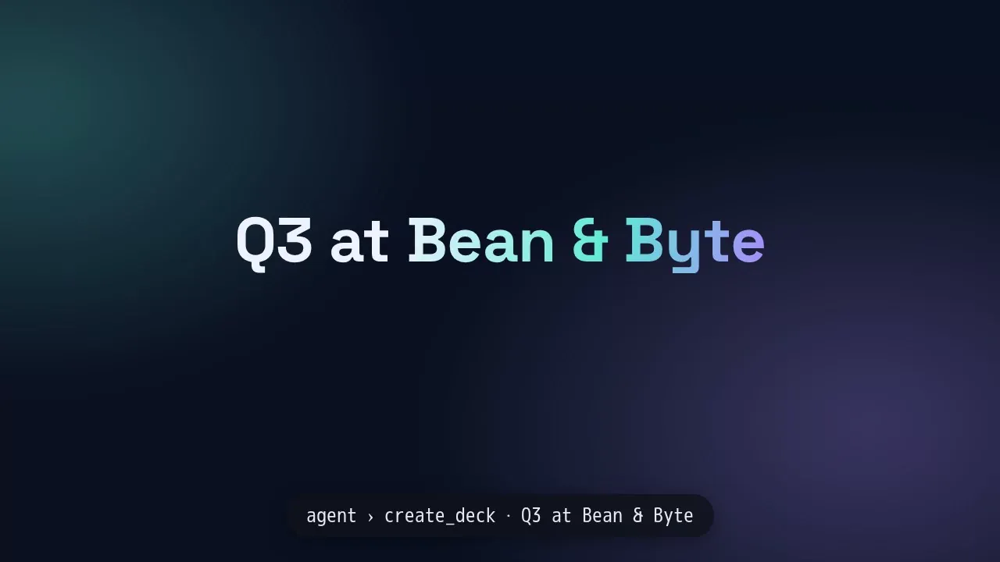
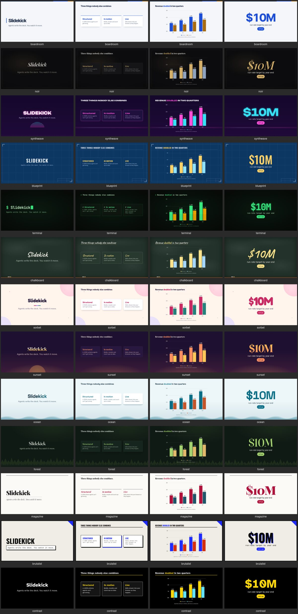
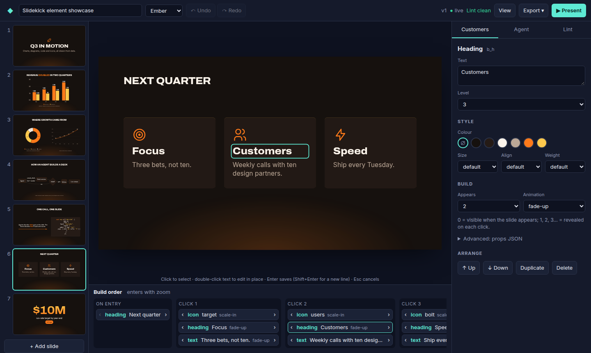
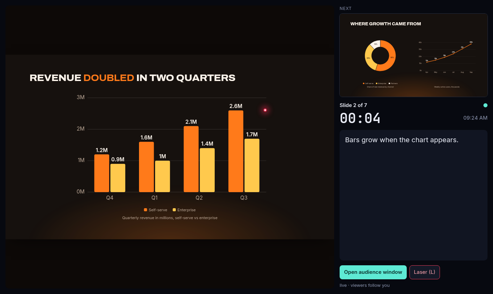
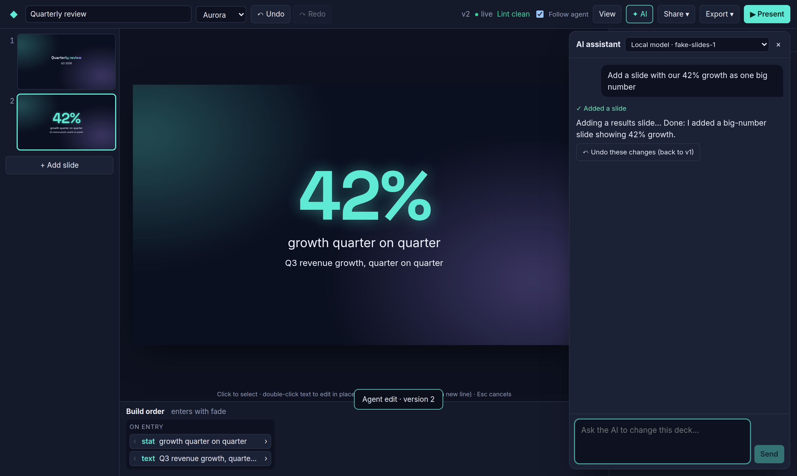
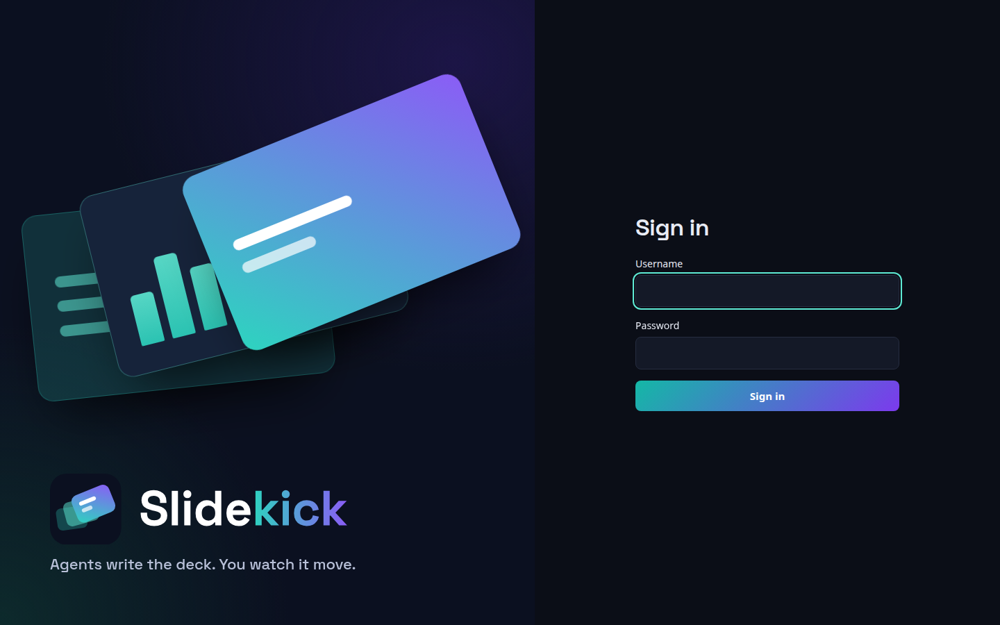

<p align="center">
  
</p>

<h1 align="center">Slidekick</h1>

<p align="center">
  <strong>Agents write the deck. You watch it move.</strong><br>
  A self-hosted, animated slideshow app built for AI agents: a single Go binary, one Docker volume.
</p>

<p align="center">
  <a href="https://github.com/SecOps-7/Slidekick/pkgs/container/slidekick"></a>
  
  
  
  <a href="LICENSE"></a>
</p>

<p align="center">
  <a href="#-quick-start">Quick start</a> ·
  <a href="#-connect-an-agent">Connect an agent</a> ·
  <a href="#-features">Features</a> ·
  <a href="#-screenshots">Screenshots</a> ·
  <a href="#-configuration">Configuration</a> ·
  <a href="#-security">Security</a> ·
  <a href="#-development">Development</a>
</p>

<p align="center">
  <br>
  <sub>Recorded live: an agent adds slides over MCP and the open viewer follows each edit, then the deck is presented with its builds.</sub>
</p>

---

## ✨ Why Slidekick

AI slide tools today either wrap Markdown (flat slides) or export a PPTX and walk away. Slidekick is different:

- **Structured, not freeform.** Agents compose elements inside layouts against a JSON Schema. They never write HTML, so the output is always valid and always looks designed.
- **Motion is built in.** Build steps, morph transitions between slides, count-up stats and charts that draw themselves.
- **Live and shared.** Every agent edit streams into your open browser. Edit the same deck, undo the agent, or leave it a comment to pick up.
- **The agent can see its work.** Every write comes back with lint findings, and `render_slide` returns a screenshot, so agents fix problems before you notice them.
- **It can present, too.** An AI walks through the deck out loud in the voice you choose, on your screen or a Chromecast, talking about what is on each slide.

---

## 🚀 Quick start

```yaml
# compose.yaml
services:
  slidekick:
    image: ghcr.io/secops-7/slidekick:latest
    restart: unless-stopped
    user: "1000:1000"
    ports: ["7410:7410", "7443:7443"]   # 7443: optional local HTTPS (Settings > General)
    env_file: [./slidekick.env]          # SLIDEKICK_TOKEN=... (chmod 600)
    environment:
      SLIDEKICK_BASE_URL: http://192.168.1.10:7410   # the address people (and TVs) use
    volumes: ["./data:/data"]
    read_only: true
    tmpfs: ["/tmp:size=512m"]           # Chromium scratch space
    shm_size: 256m
    security_opt: ["no-new-privileges:true"]
    cap_drop: [ALL]
```

```bash
echo "SLIDEKICK_TOKEN=$(openssl rand -hex 24)" > slidekick.env && chmod 600 slidekick.env
docker compose up -d
docker compose logs slidekick | grep -i setup   # the one-time code for /setup
```

Open `http://<server>:7410/setup`, create the first admin with the code from the log, and you are in.

<details>
<summary><strong>One-line <code>docker run</code></strong></summary>

<br>

```bash
read -rsp "admin password: " PW
docker run -d --name slidekick -p 7410:7410 \
  -e SLIDEKICK_ADMIN_USERNAME=admin -e SLIDEKICK_ADMIN_PASSWORD="$PW" \
  -v slidekick-data:/data --tmpfs /tmp --shm-size 256m \
  ghcr.io/secops-7/slidekick:latest
```

`SLIDEKICK_ADMIN_*` creates the first admin on first run and is ignored afterwards.

</details>

<details>
<summary><strong>About the image</strong></summary>

<br>

There is one image, for amd64 and arm64, with everything included: headless Chromium for `render_slide` screenshots and PDF/PNG export comes built in (about 890 MB). Pin a version (`:1.0.0`, or `:1.0` for patch updates) instead of `latest` if you'd rather choose when to upgrade.

</details>

<details>
<summary><strong>Build from source</strong></summary>

<br>

```bash
git clone https://github.com/SecOps-7/Slidekick.git && cd Slidekick
docker build -t slidekick:local .
```

Or without Docker (Go and Node 24):

```bash
npm --prefix web ci && npm --prefix web run build
go run ./cmd/slidekick serve      # http://localhost:7410
```

</details>

---

## 🤖 Connect an agent

Sign in, create a personal agent token on the **Account** page, and add Slidekick to your MCP client. For Claude Code:

```bash
claude mcp add --transport http slidekick http://<server>:7410/mcp \
  --header "Authorization: Bearer skp_..."
```

Then ask: *"Use Slidekick to make a 6-slide deck about our Q3 launch, check each slide with render_slide, and give me the link."* Open the link and watch it being built.

Other clients (Claude Desktop, Cursor, VS Code, stdio) are covered in [docs/agents.md](docs/agents.md).

---

## 🧭 Features

### At a glance

| | |
|---|---|
| 🤖 **Built for agents** | 29 MCP tools over streamable HTTP or stdio: create and patch decks (RFC 6902 JSON Patch), lint, `render_slide` screenshots, uploads, HTML/PDF/PNG export, comments, history and undo, private links, and presenting: run the deck out loud, step through it, and cast it to a TV. The schema, element catalogues and a design guide are resources, and `outline_to_deck`, `polish_deck` and `restyle_deck` are prompts. Every write returns the new version, lint findings and the number of open human comments. |
| 🧱 **Elements and layouts** | Headings, rich text, bullets, images, code (Shiki), big-number stats, quotes, bar/line/pie charts, Mermaid diagrams, icons, shapes, embeds, and a sandboxed HTML escape hatch that lint always flags. 9 layouts, styled with theme tokens only. |
| 📡 **Live slides** | A Live layout (a headline figure, a chart and a status line) whose content an agent keeps up to date while the deck is shown, for network or home stats: new values, and elements added or removed, change in place on every screen without redrawing the slide (`update_live`, or `POST /api/decks/<id>/live`). Off until an admin allows it; only the deck's owner, an admin or the deck's edit token can send updates. |
| 🎬 **Motion** | 28 build presets (fades and slides from any side, zoom, pop, bounce, 3D flips, iris, typewriter, line drawing...) with spring physics and stagger, per-item bullet builds, count-up stats and charts that draw in. 18 transitions, including **morph** between slides. All respect reduced motion. |
| 🎨 **Themes** | 18 themes, from corporate Boardroom and editorial Magazine to Synthwave, Terminal, Chalkboard and an accessibility-first High Contrast, all with self-hosted fonts. Tests lint every example deck in every theme and enforce contrast. [Write your own](docs/themes.md). |
| 🗣️ **AI presenting** | The built-in AI or any MCP agent presents a deck out loud: it moves through the slides and build steps and speaks about each slide's content, with the speaker notes as talking points. It never narrates the mechanics ("next slide..."); a filter removes that before anything is spoken. Each step waits until the line has been heard. |
| 🔊 **Voices** | Text-to-speech through Fish Audio, ElevenLabs, OpenAI, Cartesia, Deepgram Aura or any OpenAI-compatible server (Kokoro, Piper, LocalAI), plus free browser voices. Keys are encrypted; name several voices per provider, pick the defaults and try samples under Settings → Voices. |
| 📺 **Casting** | Cast a deck to a Chromecast from the editor, the presenter view or an agent. Devices on your network are found automatically; the TV shows a full-screen, sign-in-free view that follows the presenter and plays the narration, while the laptop stays muted unless you unmute it. |
| 💬 **AI chat** | A chat panel in the editor that works with OpenAI, Anthropic, Google or any OpenAI-compatible (local) model. It edits only the open deck, through Slidekick's own tools as the signed-in user, so roles, validation and lint apply. Stop and Undo at any time. |
| ✏️ **Editor** | Follows the agent as it works: slide sorter, inline text editing, property panel, build timeline, undo/redo across agent and human edits, and a schema check on every change. |
| 🎤 **Presenter** | Speaker notes, next slide, timer, build progress, laser pointer, an audience window for the projector, and remote followers. Captions and a Mute voice / Unmute voice button for the AI voice. |
| 📚 **Library** | Every deck shown as a live miniature of its first slide in its own theme, with search, sort, All/Mine, and a menu to share links or delete. |
| 🔐 **Accounts** | Admin, editor and viewer roles, enforced on every route, the live WebSocket and MCP. Password sign-in (argon2id) and single sign-on with OpenID Connect (Entra, Google, Authentik, Keycloak), several providers at once. Personal agent tokens and per-deck edit tokens. |
| 🔗 **Sharing** | Two kinds of link: a **viewer link** watches the deck with no controls but Fullscreen (or, with **Loop**, plays it on repeat for kiosk screens), and a **presenter link** presents it without signing in (slides, laser, AI voice, casting). Links can expire after 30 minutes to 24 hours, or never; **Make new links** revokes them all. New decks are private: only signed-in people and link holders can watch. |
| 📦 **Export** | Standalone HTML that plays offline with every animation, PDF, or PNGs. |
| ℹ️ **About** | Settings → About shows the build, the system it runs on, these release notes, and every Go module, web library and font in the build with its licence. |

<details>
<summary><strong>How an agent builds a deck</strong></summary>

<br>

1. The agent reads the schema and design guide (MCP resources) and calls `create_deck` with an outline, or `patch_deck` with JSON Patch operations.
2. Slidekick validates the change against the schema, stores a new version and streams it to every open browser, which morphs to the result.
3. The reply carries lint findings (overflowing text, low contrast, too many bullets, missing alt text) and the number of comments people have left.
4. `render_slide` returns a screenshot so the agent can check the slide the way a person sees it, then fix and repeat.
5. `focus_slide` brings the slide it is working on into your view, and you can undo any agent edit from the editor.

</details>

<details>
<summary><strong>How AI presenting works</strong></summary>

<br>

- **Automatic run.** **Present with AI voice** in the presenter view, `start_presentation` over MCP, or asking the AI chat to present. Just before each slide the configured model writes one to four sentences per build step from the slide's content (text, numbers, chart data, diagram labels, image descriptions), using the notes as intent. The next slide is prepared while the current one is spoken, so there are no gaps.
- **Step by step.** Agents can drive it themselves with `present_slide` (a slide, a build step and a line to say); it returns once the line has been heard.
- **Without an AI provider** the run reads the notes, split across build steps by blank lines.
- **Where it plays.** On the cast TV, else the audience window. The presenter view starts muted, with a Mute voice / Unmute voice button. Remote viewers on the deck's link hear it too. Captions show only in the presenter view, never for the audience.

</details>

<details>
<summary><strong>Keyboard shortcuts</strong></summary>

<br>

| Key | Where | Action |
|---|---|---|
| `→` `Space` `PageDown` | Presenter | Next build step or slide (viewers follow) |
| `←` `PageUp` | Presenter | Previous |
| `Home` `End` | Presenter | First or last slide |
| `F` | Viewer, presenter | Full screen (viewer links have no other control) |
| `L` | Presenter | Laser pointer |
| `T` | Presenter | Reset the timer |
| `Ctrl+Z` `Ctrl+Shift+Z` | Editor | Undo, redo (agent and human edits alike) |

</details>

---

## 📸 Screenshots

<table>
  <tr>
    <td colspan="2"><p align="center"><sub>Slides made by an agent, in five themes</sub></p></td>
  </tr>
  <tr>
    <td colspan="2"><p align="center"><sub>Themes, four slides each</sub></p></td>
  </tr>
  <tr>
    <td width="50%"><p align="center"><sub>Editor: slide sorter, canvas, property panel and build timeline</sub></p></td>
    <td width="50%"><p align="center"><sub>Presenter view with notes, timer and laser pointer</sub></p></td>
  </tr>
  <tr>
    <td><p align="center"><sub>The AI chat adding a slide</sub></p></td>
    <td><p align="center"><sub>Users and roles</sub></p></td>
  </tr>
  <tr>
    <td colspan="2"><p align="center"><sub>Sign in</sub></p></td>
  </tr>
</table>

---

## 🔧 Configuration

Most things are configured in the web UI (**Settings**): users and roles, single sign-on, AI providers, voices, cast devices and instance options. They are stored under `/data`, the only mount, alongside the SQLite database and uploaded files.

### Environment variables

| Variable | Default | Purpose |
|---|---|---|
| `SLIDEKICK_TOKEN` | empty | The server token: an all-powerful emergency key, kept in an owner-only env file. Also accepted as the setup code. At least 24 characters. |
| `SLIDEKICK_ADMIN_USERNAME`, `SLIDEKICK_ADMIN_PASSWORD` | empty | Create the first admin on first run (or use `/setup`). |
| `SLIDEKICK_BASE_URL` | `http://localhost:7410` | The URL people use, in share links and SSO redirects. Must be reachable from a cast TV, so use the LAN address rather than `localhost`. To serve it on its own domain too, set a public URL under Settings > General ([Public access](docs/self-hosting.md#public-access-your-own-domain)). |
| `SLIDEKICK_TRUSTED_PROXIES` | empty | Addresses of your TLS reverse proxy. Only these may set the client address and https headers. Admins can add more (a reverse proxy or a Cloudflare Tunnel) under Settings > General. |
| `SLIDEKICK_SECRET_KEY` | key file in `/data` | 32 bytes that encrypt stored SSO, AI and voice secrets. Back it up with the data. |
| `SLIDEKICK_CAST_SUBNETS` | derived | Private subnets to search for Chromecasts, such as a separate IoT VLAN (`192.168.20.0/24`). Default: the server's own LAN. |
| `SLIDEKICK_CAST_DISCOVERY` | on | `off` stops the automatic background search for cast devices. |
| `SLIDEKICK_ADDR` | `:7410` | Listen address. Plain HTTP is always served here. |
| `SLIDEKICK_HTTPS_ADDR` | `:7443` | Where local HTTPS is served once an admin turns it on under Settings > General (off by default). Publish this port to use it. |
| `SLIDEKICK_DATA` | `/data` | SQLite database and uploads. |
| `SLIDEKICK_CHROME` | auto | Path to Chromium if it isn't on `PATH`. |
| `SLIDEKICK_S3_*` | empty | Keep uploaded and exported files in an S3-compatible bucket (AWS S3, MinIO...) instead of `/data`. |

The full reference, with the S3 settings, roles, single sign-on and casting across VLANs, is in [docs/self-hosting.md](docs/self-hosting.md).

<details>
<summary><strong>Command line</strong></summary>

<br>

```text
slidekick serve              run the server (the default)
slidekick stdio              MCP over stdio, for a local agent
slidekick admin <username>   create or reset an admin from the host (password from
                             SLIDEKICK_ADMIN_PASSWORD or the first line of stdin)
slidekick version            print the version
```

</details>

---

## 🔒 Security

Slidekick is built for your **local network**. It serves plain HTTP; terminate TLS at a reverse proxy if you need it.

- **Roles everywhere.** Admin, editor and viewer roles are enforced on every REST route, the live WebSocket and MCP. Decks have one owner; only the owner or an admin changes one.
- **New decks are private.** A private deck answers 404 without its 96-bit link key, so its id can't even be confirmed.
- **Two kinds of link, both revocable.** A viewer link only watches. A presenter link presents one deck without an account (slides, AI voice, casting) and nothing else: no editing, sharing or other decks; treat it like a password, since it can spend AI and voice credits. Either can expire after 30 minutes to 24 hours, and **Make new links** ends every link at once and disconnects whoever is using one.
- **First-run setup needs a code.** Until an account exists, `/setup` needs a one-time code from the server log (or the server token).
- **Sign-in is hardened.** argon2id passwords, 14-day session cookies with CSRF protection, and lockout per address and per username. Single sign-on checks PKCE, state, nonce, issuer and audience.
- **Secrets at rest** (SSO client secrets, AI and voice keys) are encrypted with AES-256-GCM, never sent to the browser and never logged. Tokens are stored as hashes.
- **Agent content is untrusted.** Rendering in Chromium reaches only public addresses and Slidekick itself, uploads are served with a sandboxing CSP, and the `html` element runs in a sandboxed frame with no scripts.
- **Casting stays on the LAN.** The server talks to the TV directly; no port forward, tunnel or public URL is used.
- **Framing is refused** on every page. An admin can let listed sites embed viewer links (Settings > General); the editor, presenter view, presenter links and sign-in are never frameable.
- **Local HTTPS without a proxy** (optional, off by default): Slidekick can serve HTTPS itself with your certificate or one from its own certificate authority, which is limited to private addresses and local names. Nothing is requested from the internet.
- **Don't publish port 7410 to the internet.** To let people watch from anywhere, serve Slidekick on its own domain through an HTTPS reverse proxy or a tunnel such as Cloudflare Tunnel, and set **Public access** (Settings > General): links then use that domain, and forwarding headers are believed only from the proxies you list. See [Public access](docs/self-hosting.md#public-access-your-own-domain). A VPN keeps it private altogether.

To report a vulnerability, see [SECURITY.md](SECURITY.md).

---

## 🧩 How it works

```
Agents (MCP: HTTP /mcp or stdio)        Browsers (editor, viewer, presenter, TV)
            │                                        │  REST + live WebSocket
            └──────────────┬─────────────────────────┘
                           │
  internal/server      HTTP routes, sessions, CSRF, the live hub
  internal/mcpserver   the 29 MCP tools, resources and prompts
  internal/service     one place for every deck operation, with authz checks
  internal/deck        the JSON Schema contract, validation and JSON Patch
  internal/lint        design lint returned with every write
  internal/store       SQLite (pure Go): decks, versions, users, settings
  internal/render      headless Chromium for render_slide and PDF/PNG
  internal/presenting  AI presenting: script writing and pacing
  internal/tts         text-to-speech engines     internal/cast   Chromecast
  internal/ai, llm     the AI chat and its providers
                           │
  web/src              Preact + TypeScript, built with Vite and embedded in the binary
```

The browser and the server share one contract: the TypeScript types and the editor's validator are generated from the JSON Schema in `schema/`.

---

## 💻 Development

```bash
npm --prefix web ci && npm --prefix web run build
go test ./... && npm --prefix web test
go run ./cmd/slidekick serve      # http://localhost:7410
```

Golden screenshots of every example deck are compared in CI. Read [CONTRIBUTING.md](CONTRIBUTING.md) for the local setup and the project's conventions.

---

## 🤝 Contributing

Issues and pull requests are welcome, from typo fixes to new themes. Check the [open issues](https://github.com/SecOps-7/Slidekick/issues) first, and open one before a large change so the approach can be agreed. See [CONTRIBUTING.md](CONTRIBUTING.md).

---

## 📄 License

MIT, see [LICENSE](LICENSE). Fonts are under the SIL Open Font License (see `themes/fonts/licenses`); icons are [Tabler Icons](https://tabler.io/icons) (MIT). Every bundled library and its licence is listed on the About page.

<p align="center"><sub>Built with the help of <a href="https://claude.ai">Claude</a> by Anthropic.</sub></p>
