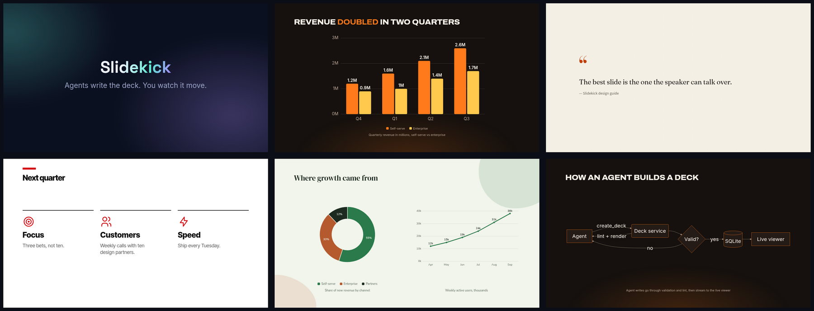

# Slidekick

**Agents write the deck. You watch it move.**

Slidekick is a self-hosted slideshow app for the age of agents. Your AI agent builds animated, on-brand decks through [MCP](https://modelcontextprotocol.io); you watch them come together live in the browser, edit alongside it, and present. One Go binary, one Docker image, MIT licensed.



## Why

AI slide tools today either wrap Markdown (flat slides) or export PPTX and walk away. Slidekick is different:

- **Structured, not freeform.** Agents compose elements inside layouts against a JSON Schema. They never write HTML, so the output is always valid and always looks designed.
- **Motion is built in.** Build steps, morph transitions between slides, count-up stats, charts that draw themselves.
- **Live and shared.** Every agent edit streams into your open browser. You can edit the same deck, undo the agent, or pin a request for it ("Send to agent").
- **The agent can see its work.** Every write comes back with lint findings, and `render_slide` returns a screenshot, so agents fix problems before you notice them.

## Quick start

```bash
TOKEN=$(openssl rand -hex 24); echo "your token: $TOKEN"
docker run -d --name slidekick -p 7410:7410 -e SLIDEKICK_TOKEN="$TOKEN" \
  -v slidekick-data:/data --tmpfs /tmp --shm-size 256m \
  ghcr.io/secops-7/slidekick:latest-render
```

Connect Claude Code (other clients: [docs/agents.md](docs/agents.md)):

```bash
claude mcp add --transport http slidekick http://localhost:7410/mcp \
  --header "Authorization: Bearer $TOKEN"
```

Then ask: *"Use Slidekick to make a 6-slide deck about our Q3 launch, check each slide with render_slide, and give me the link."*

## What you get

| | |
| --- | --- |
| **For agents** | 20 MCP tools: create and patch decks (RFC 6902), lint, screenshots, uploads, HTML/PDF/PNG export, comments, history and undo, private links. Plus the schema, catalogues and a design guide as resources. |
| **Elements** | Headings, rich text, bullets, images, code (Shiki), big-number stats, quotes, bar/line/pie charts, Mermaid diagrams, 99 icons, shapes, embeds, and a sandboxed HTML escape hatch. 8 layouts. |
| **Motion** | Fade, fade-up, scale-in, wipe, typewriter and line-drawing builds with spring physics; fade, slide, push, zoom and **morph** transitions; respects `prefers-reduced-motion`. |
| **Sharing** | Public or private (keyed) links, and per-deck edit tokens for agents or colleagues. |
| **Themes** | Aurora, Paper, Swiss, Ember and Meadow, with self-hosted fonts. Write your own: [docs/themes.md](docs/themes.md). |
| **Editor** | Follows the agent as it works; slide sorter, inline text editing, property panel, build timeline, undo/redo across agent and human edits. |
| **Presenter** | Speaker notes, next slide, timer, build progress, laser pointer; audience window and remote viewers follow along. |
| **Export** | Standalone HTML that plays offline with every animation, PDF, or PNGs. |


## Run it for real

Docker Compose, TLS, configuration and the security model: [docs/self-hosting.md](docs/self-hosting.md).

| Variable | Default | |
| --- | --- | --- |
| `SLIDEKICK_TOKEN` | empty | Required for every write. At least 24 characters. |
| `SLIDEKICK_BASE_URL` | `http://localhost:7410` | Public URL used in share links |
| `SLIDEKICK_DATA` | `/data` | SQLite database and uploads |
| `SLIDEKICK_ADDR` | `:7410` | Listen address |

Files can live in an S3-compatible bucket instead of the data folder: see the `SLIDEKICK_S3_*` variables in [docs/self-hosting.md](docs/self-hosting.md#configuration).

Two images: `-render` (with Chromium, for screenshots and PDF/PNG export) and a slim distroless one. Both for amd64 and arm64.

## Develop

```bash
npm --prefix web ci && npm --prefix web run build
go test ./... && npm --prefix web test
go run ./cmd/slidekick serve      # http://localhost:7410
```

See [CONTRIBUTING.md](CONTRIBUTING.md). Report security issues privately: [SECURITY.md](SECURITY.md).

## License

MIT. Fonts are SIL Open Font License (see `themes/fonts/licenses`); icons are [Tabler Icons](https://tabler.io/icons) (MIT).
