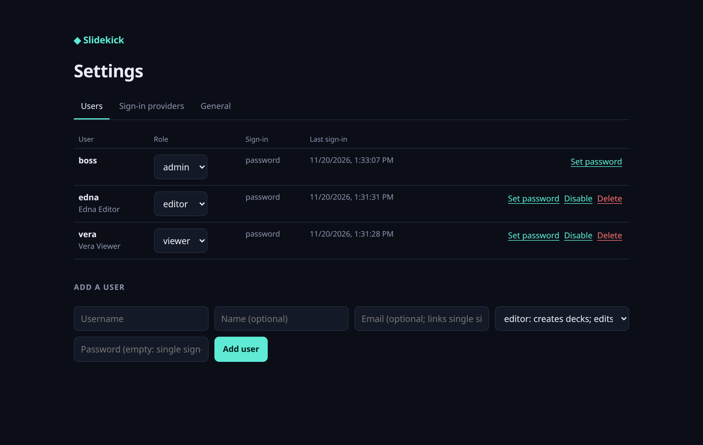

# Self-hosting

Slidekick is one container. Pick an image:

| Image | Size | What you get |
| --- | --- | --- |
| `ghcr.io/secops-7/slidekick:<version>-render` | ~890 MB | Everything, including `render_slide` and PDF/PNG export (headless Chromium) |
| `ghcr.io/secops-7/slidekick:<version>` | ~32 MB | Everything except screenshots and PDF/PNG export |

Both are multi-arch (amd64, arm64) and run as a non-root user.

## Docker Compose

```yaml
services:
  slidekick:
    image: ghcr.io/secops-7/slidekick:1-render
    restart: unless-stopped
    user: "1000:1000"
    ports: ["7410:7410"]
    env_file: [./slidekick.env]          # SLIDEKICK_TOKEN=... (chmod 600)
    environment:
      SLIDEKICK_BASE_URL: https://slides.example.com
    volumes: ["./data:/data"]
    read_only: true
    tmpfs: ["/tmp:size=512m"]           # Chromium scratch space (render image)
    shm_size: 256m
    security_opt: ["no-new-privileges:true"]
    cap_drop: [ALL]
```

Create the token with `openssl rand -hex 24`. Slidekick refuses to start with a token shorter than 24 characters.

## Configuration

| Variable | Default | |
| --- | --- | --- |
| `SLIDEKICK_TOKEN` | empty | Server token: full access for automation and recovery (MCP, REST API, and the setup code for the first admin). Optional once accounts exist. At least 24 characters. |
| `SLIDEKICK_ADMIN_USERNAME` | empty | With `SLIDEKICK_ADMIN_PASSWORD`, creates this admin on first run when no account exists yet. Ignored afterwards. |
| `SLIDEKICK_ADMIN_PASSWORD` | empty | Password for that first admin (at least 10 characters). A secret: keep it in the `env_file`. |
| `SLIDEKICK_SECRET_KEY` | key file | 32 bytes (`openssl rand -hex 32`) that encrypt stored secrets: SSO client secrets and AI provider keys. Without it Slidekick creates `SLIDEKICK_DATA/secret.key` (mode 600) on first run; back it up with the data, because the stored secrets can't be decrypted without it. |
| `SLIDEKICK_BASE_URL` | `http://localhost:<port>` | Public URL used in share and download links. |
| `SLIDEKICK_ADDR` | `:7410` | Listen address. |
| `SLIDEKICK_DATA` | `/data` | SQLite database and uploaded files. Back this folder up. |
| `SLIDEKICK_CHROME` | auto | Path to Chromium if it isn't on `PATH`. |
| `SLIDEKICK_S3_BUCKET` | empty | Store uploaded and exported files in this S3-compatible bucket instead of `SLIDEKICK_DATA/files`. Setting it turns S3 on; the bucket must already exist. |
| `SLIDEKICK_S3_ENDPOINT` | empty | `host:port` of the S3 API, without a scheme (for example `s3.eu-central-1.amazonaws.com` or `minio:9000`). Required with a bucket. |
| `SLIDEKICK_S3_REGION` | empty | Bucket region, if your provider needs one. |
| `SLIDEKICK_S3_ACCESS_KEY` | empty | Access key. Required with a bucket. |
| `SLIDEKICK_S3_SECRET_KEY` | empty | Secret key. Required with a bucket. Keep it in the `env_file`, not in the compose file; it is never logged. |
| `SLIDEKICK_S3_PREFIX` | empty | Optional key prefix, such as `slidekick/`, to share a bucket. |
| `SLIDEKICK_S3_INSECURE` | `0` | `1` talks plain HTTP to the endpoint, for a local MinIO. Leave it off for anything across a network. |

With S3 enabled, Slidekick checks the bucket at startup and refuses to start if it can't reach it. Deck data and file metadata stay in SQLite under `SLIDEKICK_DATA`, so you still back that folder up; files already on disk are not moved to the bucket for you (copy `SLIDEKICK_DATA/files/*` to the bucket under the same names and prefix).

## Accounts, roles and sign-in

Everyone signs in with a username and password or through single sign-on. Roles:

| Role | Can |
| --- | --- |
| **admin** | Everything: every deck, users, sign-in providers, AI providers and instance settings. |
| **editor** | Create decks; edit, share (private links, deck tokens) and export **their own** decks; upload files; use AI. View, present and comment on every deck. |
| **viewer** | View, present and comment on every deck. |

**Decks have owners.** The person (or the personal agent token) that creates a deck owns it. Signed-in people see every deck on the instance, like a shared team library, but only the owner and admins can change one. Turn on **Settings → General → Editors can edit every deck** for a team that edits everything together. Admins can hand a deck to someone else (`PUT /api/decks/<id>/owner`). Deleting a user moves their decks to the admin who deletes them.

These rules are enforced by the server on every request (REST, the live WebSocket and MCP); the web app only hides what you can't use.



### The first admin

- **New install:** set `SLIDEKICK_ADMIN_USERNAME` and `SLIDEKICK_ADMIN_PASSWORD` for the first run, or open `/setup` and enter the one-time setup code from the log (`docker logs slidekick | grep setup_code`). Until the first admin exists and no server token is set, the server is open to anyone who can reach it, as before; set it up straight away.
- **Upgrading an install that used `SLIDEKICK_TOKEN`:** nothing stops working. The token keeps full access, decks keep their links, and `/setup` accepts the token as the setup code. The first admin becomes the owner of every existing deck.
- **Locked out?** Reset or create an admin from the host: `docker exec -i slidekick slidekick admin <username>` and type the new password. It works while the server runs.

Passwords are hashed with argon2id (64 MB, 3 passes). Sessions are 14-day `HttpOnly`, `SameSite=Lax` cookies (`Secure` when `SLIDEKICK_BASE_URL` is https); only their SHA-256 is stored. Every write from a browser also needs the session's CSRF token and a same-origin request. Ten failed sign-ins from one address, or against one username, within a minute lock it out for five minutes. Changing a password signs out the account's other sessions; disabling a user ends theirs immediately.

### Agents

Agents authenticate MCP with a bearer token:

- **Personal agent tokens** (`skp_...`, from the **Account** page) act as you, with your role: an agent can never do more than you. Decks it creates are yours. This is the recommended way.
- **Deck tokens** (`ske_...`, editor **Share** menu) edit one deck only. Its owner or an admin can create one.
- **The server token** (`SLIDEKICK_TOKEN`) still works for everything. Moving agents to personal tokens is the migration: create a token on the Account page, swap it into `claude mcp add ... --header "Authorization: Bearer skp_..."`, and decks the agent creates get an owner. Then you can remove `SLIDEKICK_TOKEN` (keep it if you want a recovery path besides `slidekick admin`).

### Single sign-on (OpenID Connect)

Admins add providers under **Settings → Sign-in providers**: Microsoft Entra, Google, Authentik, Keycloak or any OpenID Connect provider, several at once. Each needs the issuer URL, a client ID and secret (stored encrypted, never shown again), and this redirect URL registered at the provider:

```
<SLIDEKICK_BASE_URL>/auth/sso/<provider id>/callback
```


Slidekick uses discovery, the authorization code flow with PKCE, and checks state (bound to the browser by a cookie), nonce, issuer, audience, expiry and signature. The issuer may be typed with or without a trailing slash: Slidekick accepts a single-slash difference from what discovery publishes and then verifies tokens against the exact published issuer. Use **Test** to check discovery.

- **Accounts:** a sign-in finds the account already linked to that provider. Otherwise it links to an existing account with the same email, but only if the provider marks the email verified (or you ticked **Trust this provider's email addresses**, for Entra work accounts, which send no `email_verified`). Otherwise, if **Create accounts for new people automatically** is on, a new account gets the default role; if it's off, the person is told to ask an admin.
- **Roles:** rules map a group (from the groups claim) or an email or email domain to a role. The first matching rule wins and is applied at every sign-in, so removing someone from the group in your directory demotes them at their next sign-in. Group claims need the provider configured to send them (Entra: token configuration → groups claim; Keycloak: a group mapper; Authentik: the default `groups` scope).
- Provider notes: Entra issuer `https://login.microsoftonline.com/<tenant id>/v2.0` (multi-tenant `common` isn't supported); Google `https://accounts.google.com`; Authentik `https://<host>/application/o/<slug>/`; Keycloak `https://<host>/realms/<realm>`. Providers on your LAN work: only an admin can add them.

## TLS and reverse proxies

Slidekick speaks plain HTTP. Put it behind a TLS-terminating proxy (Caddy, Traefik, nginx) for anything beyond a trusted LAN, so the token never crosses the network in clear text. The proxy must pass WebSockets on `/ws/`.

Caddy:

```
slides.example.com {
  reverse_proxy slidekick:7410
}
```

Failed sign-in and token lockouts are per client IP (and per username for sign-ins). Behind a proxy every client shares the proxy's IP, so a burst of bad tokens locks everyone out for five minutes.

## Security model

- **Accounts and roles** decide who can list, edit, share, export and administer (see above). Signed-in people of any role can view every deck.
- **Viewing is also by link**: anyone with a deck link (`/d/<id>`, 80-bit random id) can watch it live and download its HTML export, signed in or not. Treat links like unlisted documents, or make the deck private.
- **Private decks** need a key in the link as well (`/d/<id>?k=<key>`, 96-bit). Without it the deck answers 404, so its id can't even be confirmed. Make a deck private from the editor's **Share** menu or with the `set_deck_access` tool; **Make a new link** rotates the key and disconnects anyone watching with the old one. Signed-in people and token holders for the deck can always view it.
- **Everything else needs a signed-in account or a token**: editing, presenting to remote viewers, uploads, PDF/PNG export, listing decks, MCP, settings. Tokens are stored as hashes; revoking one, or disabling its user, takes effect on the next request, and an MCP session can't switch to another principal midway.
- **Stored secrets** (SSO client secrets, AI provider keys) are encrypted with AES-256-GCM under `SLIDEKICK_SECRET_KEY` or the key file, are never sent to the browser and never logged.
- **Rendering is sandboxed from your network**: headless Chromium reaches only public internet addresses and Slidekick itself, so deck content can't read internal services through `render_slide`.
- **Uploads** are content-addressed, type-checked and served with a sandboxing Content-Security-Policy. Their URLs are unguessable (80-bit hashes) but not tied to a deck, so a private deck's images are as private as their links.
- **The `html` element** (an escape hatch for agents) renders in a sandboxed frame: no scripts, no same-origin access, no forms, and its own CSP allows only https images and fonts.

See [SECURITY.md](../SECURITY.md) to report a vulnerability.

## Backups and upgrades

Stop the container (or not: SQLite runs in WAL mode) and copy `SLIDEKICK_DATA`. Upgrades are pull-and-restart; decks are migrated forward on load. Each deck keeps its last 500 versions.
