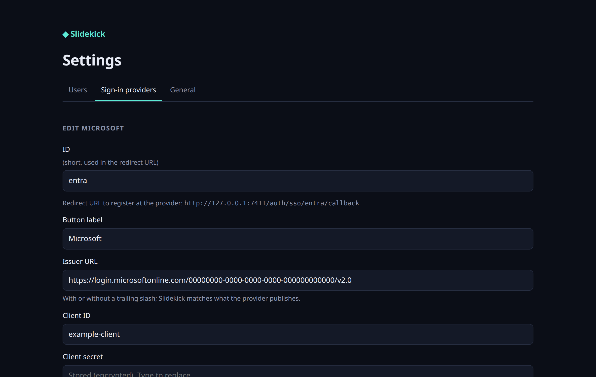

# Self-hosting

Slidekick is one container: `ghcr.io/secops-7/slidekick:latest` (or a version, `:1.0.0`, or `:1.0` for patch updates). The image includes headless Chromium for `render_slide` and PDF/PNG export (about 890 MB), is multi-arch (amd64, arm64) and runs as a non-root user.

## Docker Compose

```yaml
services:
  slidekick:
    image: ghcr.io/secops-7/slidekick:latest
    restart: unless-stopped
    user: "1000:1000"
    ports: ["7410:7410", "7443:7443"]   # 7443: optional local HTTPS (Settings > General)
    env_file: [./slidekick.env]          # SLIDEKICK_TOKEN=... (chmod 600)
    environment:
      SLIDEKICK_BASE_URL: https://slides.example.com
    volumes: ["./data:/data"]
    read_only: true
    tmpfs: ["/tmp:size=512m"]           # Chromium scratch space
    shm_size: 256m
    security_opt: ["no-new-privileges:true"]
    cap_drop: [ALL]
```

Create the token with `openssl rand -hex 24`. Slidekick refuses to start with a token shorter than 24 characters.

## Configuration

| Variable | Default | |
| --- | --- | --- |
| `SLIDEKICK_TOKEN` | empty | The server token: an all-powerful emergency key (see [The server token](#the-server-token-emergency-key)). Also accepted as the setup code for the first admin. At least 24 characters. |
| `SLIDEKICK_TRUSTED_PROXIES` | empty | Addresses (or CIDR ranges) of your TLS reverse proxy, comma-separated. Only these peers may set the client address and `X-Forwarded-Proto`. See [TLS on the LAN](#tls-on-the-lan). |
| `SLIDEKICK_ADMIN_USERNAME` | empty | With `SLIDEKICK_ADMIN_PASSWORD`, creates this admin on first run when no account exists yet. Ignored afterwards. |
| `SLIDEKICK_ADMIN_PASSWORD` | empty | Password for that first admin (at least 10 characters). A secret: keep it in the `env_file`. |
| `SLIDEKICK_SECRET_KEY` | key file | 32 bytes (`openssl rand -hex 32`) that encrypt stored secrets: SSO client secrets and AI provider keys. Without it Slidekick creates `SLIDEKICK_DATA/secret.key` (mode 600) on first run; back it up with the data, because the stored secrets can't be decrypted without it. |
| `SLIDEKICK_BASE_URL` | `http://localhost:<port>` | The URL people use, in share and download links and SSO redirect URLs: `https://<internal hostname>` once TLS is set up. |
| `SLIDEKICK_ADDR` | `:7410` | Listen address for plain HTTP, which is always served. |
| `SLIDEKICK_HTTPS_ADDR` | `:7443` | Listen address for [local HTTPS](#local-https), once an admin turns it on (off by default). Publish the port in Compose to reach it. |
| `SLIDEKICK_DATA` | `/data` | SQLite database and uploaded files. Back this folder up. |
| `SLIDEKICK_CHROME` | auto | Path to Chromium if it isn't on `PATH`. |
| `SLIDEKICK_CAST_SUBNETS` | derived | Private IPv4 subnets (comma-separated CIDRs) to scan for Chromecasts. Default: the /24 of the base URL's LAN address and of the machine's own LAN interfaces. At most 1024 addresses; public ranges are refused. See [Casting to a TV](#casting-to-a-tv). |
| `SLIDEKICK_CAST_DISCOVERY` | on | `off` stops the automatic background search for cast devices and keeps found devices out of cast menus (admins can still scan by hand). |
| `SLIDEKICK_S3_BUCKET` | empty | Store uploaded and exported files in this S3-compatible bucket instead of `SLIDEKICK_DATA/files`. Setting it turns S3 on; the bucket must already exist. |
| `SLIDEKICK_S3_ENDPOINT` | empty | `host:port` of the S3 API, without a scheme (for example `s3.eu-central-1.amazonaws.com` or `minio:9000`). Required with a bucket. |
| `SLIDEKICK_S3_REGION` | empty | Bucket region, if your provider needs one. |
| `SLIDEKICK_S3_ACCESS_KEY` | empty | Access key. Required with a bucket. |
| `SLIDEKICK_S3_SECRET_KEY` | empty | Secret key. Required with a bucket. Keep it in the `env_file`, not in the compose file; it is never logged. |
| `SLIDEKICK_S3_PREFIX` | empty | Optional key prefix, such as `slidekick/`, to share a bucket. |
| `SLIDEKICK_S3_INSECURE` | `0` | `1` talks plain HTTP to the endpoint, for a local MinIO. Leave it off for anything across a network. |

With S3 enabled, Slidekick checks the bucket at startup and refuses to start if it can't reach it. Deck data and file metadata stay in SQLite under `SLIDEKICK_DATA`, so you still back that folder up; files already on disk are not moved to the bucket for you (copy `SLIDEKICK_DATA/files/*` to the bucket under the same names and prefix).

## Accounts, roles and sign-in

Everyone signs in with a username and password or through single sign-on. Roles:

| Role | Can |
| --- | --- |
| **admin** | Everything: every deck, users, sign-in providers, AI providers and instance settings. |
| **editor** | Create decks; edit, share (viewer and presenter links, deck tokens) and export **their own** decks; upload files; use AI. View, present and comment on every deck. |
| **viewer** | View, present and comment on every deck. |

**Decks have one owner** (decided 2026-11-20, see [decisions](decisions.md)). The person (or the personal agent token) that creates a deck owns it. Signed-in people see every deck on the instance, like a shared team library, but only the owner and admins can change one. There are no per-deck collaborators; turn on **Settings → General → Editors can edit every deck** for a team that edits everything together. Admins can hand a deck to someone else (`PUT /api/decks/<id>/owner`). **Deleting a deck** (the **Delete** button on the home page) is for its owner and admins only, even when editors can edit every deck; it removes the slides, history, comments and links for good, and anyone watching is told. Deleting a user moves their decks to the admin who deletes them.

**New decks are private** (decided 2026-11-20): watching one needs a sign-in or its private link. Decks created before that change stay public by link.

These rules are enforced by the server on every request (REST, the live WebSocket and MCP); the web app only hides what you can't use.


### The first admin

- **New install:** set `SLIDEKICK_ADMIN_USERNAME` and `SLIDEKICK_ADMIN_PASSWORD` for the first run, or open `/setup` and enter the one-time setup code from the log (`docker logs slidekick | grep setup_code`). Until the first admin exists and no server token is set, the server is open to anyone who can reach it, as before; set it up straight away.
- **Upgrading an install that used `SLIDEKICK_TOKEN`:** nothing stops working. The token keeps full access, decks keep their links, and `/setup` accepts the token as the setup code. The first admin becomes the owner of every existing deck.
- **Locked out?** Reset or create an admin from the host: `docker exec -i slidekick slidekick admin <username>` and type the new password. It works while the server runs.

Passwords are hashed with argon2id (64 MB, 3 passes). Sessions are 14-day `HttpOnly`, `SameSite=Lax` cookies, marked `Secure` whenever the request arrived over https (directly or through the trusted proxy); only their SHA-256 is stored. Every write from a browser also needs the session's CSRF token and a same-origin request. Ten failed sign-ins from one address, or against one username, within a minute lock it out for five minutes. Changing a password signs out the account's other sessions; disabling a user ends theirs immediately.

### Agents

Agents authenticate MCP with a bearer token:

- **Personal agent tokens** (`skp_...`, from the **Account** page) act as you, with your role: an agent can never do more than you. Decks it creates are yours. This is the recommended way.
- **Deck tokens** (`ske_...`, editor **Share** menu) edit one deck only. Its owner or an admin can create one.
- **The server token** (`SLIDEKICK_TOKEN`) also works, with full access; keep it for emergencies (below). Moving agents to personal tokens: create a token on the Account page, swap it into `claude mcp add ... --header "Authorization: Bearer skp_..."`, and decks the agent creates get an owner.

### The server token (emergency key)

`SLIDEKICK_TOKEN` is an all-powerful emergency key: whoever holds it can read, change and delete every deck, manage every user and setting, and act over MCP without any account. It stays configured as a backstop (decided 2026-11-20) for when nobody can sign in, and as the setup code for the first admin. Day-to-day agents use personal tokens instead.

- **Where it lives:** only in the deployment's owner-only env file, the one named by `env_file:` in the compose file (for example `/opt/slidekick/slidekick.env`, mode 600, in a folder only its owner can open). Never in the compose file, the stack's `.env`, the repository, shell history or chat.
- **Using it without showing it:** read it from that file in the same command, e.g. ``T=$(sed -n 's/^SLIDEKICK_TOKEN=//p' /opt/slidekick/slidekick.env); curl -H "Authorization: Bearer $T" ...; unset T``. Slidekick never logs or displays it.
- **Rotating it:** put a new value (`openssl rand -hex 24`) in that file and recreate the container; the old one stops working at once.

### Single sign-on (OpenID Connect)

Admins add providers under **Settings → Sign-in providers**: Microsoft Entra, Google, Authentik, Keycloak or any OpenID Connect provider, several at once. Each needs the issuer URL, a client ID and secret (stored encrypted, never shown again), and this redirect URL registered at the provider:

```
<SLIDEKICK_BASE_URL>/auth/sso/<provider id>/callback
```



Slidekick uses discovery, the authorization code flow with PKCE, and checks state (bound to the browser by a cookie), nonce, issuer, audience, expiry and signature. The issuer may be typed with or without a trailing slash: Slidekick accepts a single-slash difference from what discovery publishes and then verifies tokens against the exact published issuer. Use **Test** to check discovery.

- **Accounts:** a sign-in finds the account already linked to that provider. Otherwise it links to an existing account with the same email, but only if the provider marks the email verified (or you ticked **Trust this provider's email addresses**, for Entra work accounts, which send no `email_verified`). Otherwise, if **Create accounts for new people automatically** is on, a new account gets the default role; if it's off, the person is told to ask an admin.
- **Roles:** rules map a group (from the groups claim) or an email or email domain to a role. The first matching rule wins and is applied at every sign-in, so removing someone from the group in your directory demotes them at their next sign-in. Group claims need the provider configured to send them (Entra: token configuration → groups claim; Keycloak: a group mapper; Authentik: the default `groups` scope).
- Provider notes: Entra issuer `https://login.microsoftonline.com/<tenant id>/v2.0` (multi-tenant `common` isn't supported); Google `https://accounts.google.com`; Authentik `https://<host>/application/o/<slug>/`; Keycloak `https://<host>/realms/<realm>`. Providers on your LAN work: only an admin can add them.

## AI providers and the chat panel

Admins connect AI providers under **Settings → AI providers**: OpenAI, Anthropic, Google Gemini, or any OpenAI-compatible endpoint (Ollama, LM Studio, vLLM, LiteLLM and other local or self-hosted models). Each has a base URL, an API key (optional for local servers) and the list of models people may use; **Save and fetch models** asks the provider for its list.

Editors and admins then get an **✦ AI** button in the editor. The chat always works on the deck that's open in front of you: it can't create other decks or change any deck but this one. Before it works on a slide it brings that slide into view, and if your message names one ("make slide 4 punchier"), slide 4 comes into view straight away. They pick a provider and model and ask for changes ("add a slide with our 42% growth as one big number", "restyle this for a board meeting"). Replies stream in, each step is listed (✓ added a slide, ✗ refused...), the editor follows along as the changes land, **Stop** cancels the run, and **Undo these changes** restores the deck to the version from before the run (as a new version, so history keeps everything). Viewers can't use AI.


How it stays safe:

- **The AI acts as the person asking.** The server runs the model and applies its changes through Slidekick's own MCP tools with a token that acts as the signed-in user, lives only for that request and is revoked when it ends. Every call goes through the same role and ownership checks as any agent, so an editor's AI can't change someone else's deck, and nobody's AI can change sharing, upload files, export or reach settings (those tools aren't offered to the chat at all).
- **Its output is untrusted.** Changes go through schema validation, sanitising and lint like any agent's: invalid elements are refused and the model is told why. The `html` element stays sandboxed. The model is told to treat deck content as data, never as instructions.
- **Keys stay on the server.** They're stored encrypted (AES-256-GCM, see `SLIDEKICK_SECRET_KEY`), never sent to the browser, and removed from any provider error before it's shown or logged. Google's key goes in a header, never in a URL.
- **Outbound calls go only to the configured provider.** Each provider's HTTP client can connect only to the host and port of its base URL (checked after DNS), ignores proxy settings and refuses redirects. A provider on your home network works because an admin set it; nobody else can add a URL. Nothing is exposed to the internet: Slidekick only makes outgoing requests.
- **Limits:** two chats per person at once, 24 model turns and 10 minutes per message, 8,000 characters per message.

Providers bill by usage; the chat sends the design guide, the layout list and the tool definitions with each request.

## Voices (text-to-speech)

Voices speak the narration when a deck is presented by the AI (see AI presenting below). Admins set up voices under **Settings → Voices**: connect providers, load each one's voice list, **Play sample**, and pick the **default for narration** (provider and voice). Keys are handled exactly like AI provider keys: stored encrypted, never sent to the browser, removed from errors, and each provider's client can reach only its own base URL. Every engine is asked for MP3.

| Provider | Needs | Voice |
|---|---|---|
| **Browser voices (free)** | Nothing. Built in; the presenter's browser speaks with its own voices (`speechSynthesis`), so quality and choice depend on the browser and OS. The server never calls anything. | A voice name the browser offers |
| **Fish Audio** | API key from fish.audio. Model: `s1`, `s2-pro`, `s2.1-pro` (default) or `s2.1-pro-free`. | A voice model id (`reference_id`), listed from your own and popular public models |
| **ElevenLabs** | API key. Model defaults to `eleven_multilingual_v2`. | A voice id from your voice library |
| **OpenAI** | API key. Model defaults to `gpt-4o-mini-tts` (`tts-1`, `tts-1-hd` also work). | alloy, ash, ballad, cedar, coral, echo, fable, marin, nova, onyx, sage, shimmer, verse |
| **Cartesia** | API key. Model defaults to `sonic-3.6`. | A voice id from your Cartesia voices |
| **Deepgram Aura** | API key. | The Aura model is the voice, e.g. `aura-2-thalia-en` |
| **OpenAI-compatible (self-hosted)** | Base URL of a server speaking OpenAI's `/v1/audio/speech`: Kokoro-FastAPI (`http://host:8880/v1`, model `kokoro`), openedai-speech / Piper (model `tts-1`), LocalAI (your model name). Key optional. | Whatever the server offers; Kokoro's list is loaded from `/v1/audio/voices`, others get the OpenAI names, which they map to their own voices |

Editors and admins can list voices (`GET /api/tts/voices?provider=`). Long notes are split at sentence ends to fit each provider's limit (4,000 characters per request, 2,000 for Deepgram; 20,000 per narration). Generated audio is kept in memory for 30 minutes after its last use and served from an unguessable URL (`/api/tts/audio/<hash>.mp3`) so a cast receiver can play it without signing in. Providers bill per character.

## Casting to a TV

Slidekick can show a deck on a Chromecast (or a TV with Chromecast built in) on your network. The server talks to the device itself, over the Cast protocol (TLS on TCP port 8009), and tells it to open the deck's **cast view**: `<SLIDEKICK_BASE_URL>/d/<deck id>/present?k=<view key>&cast=1`. That page shows only the slides, with no controls and no cursor, and follows whoever drives the deck: the presenter view, and agents or the AI bringing a slide into view. It keeps reconnecting on its own. The view key in the link lets a private deck open on the TV without anyone signing in there.

- **LAN only.** Nothing is exposed to the internet: no port forward, tunnel or public URL is needed or used.
- **Devices are found automatically.** Shortly after it starts (about 20 seconds), every 10 minutes, and when someone presses **Refresh** in the Cast menu or an admin presses **Scan now**, Slidekick looks for Chromecasts two ways at once:
  - **mDNS** (`_googlecast._tcp`), for two to three seconds. mDNS is multicast, which doesn't cross Docker's default bridge network, so in a normal container it finds nothing. Host networking (`network_mode: host`, or a macvlan network) makes it work, but it isn't required.
  - **A subnet scan**, which works from the bridge network because it is ordinary outgoing TCP: a short (400 ms) connection attempt to port 8009 on every address of the LAN's /24, 64 at a time, so a /24 takes two or three seconds. Whatever answers is asked its name and model at `/setup/eureka_info` (HTTPS on 8443, then HTTP on 8008, the endpoint the Google Home app reads and the one setup endpoint that needs no token); a device that doesn't answer there is confirmed with a Cast status request and listed as "Cast device (<ip>)". Discovery never launches anything on a TV.
  - **What is scanned:** `SLIDEKICK_CAST_SUBNETS` when set (comma-separated CIDRs, like `192.168.1.0/24,192.168.20.0/24`), else the /24 around the address in `SLIDEKICK_BASE_URL` (a host name is resolved) plus the /24 of each of the machine's own LAN interfaces (Docker's bridge and other virtual interfaces are skipped). Only private ranges (10/8, 172.16/12, 192.168/16) are ever scanned, and at most 1024 addresses in all: larger or public lists are refused, and the server log and the settings page say why.
  - **Identity:** a device is recognised by its own id (the mDNS id, or its UDN from eureka_info), so when the router gives it a new address it stays the same device, and a saved device's address is updated to follow it.
- **Cast menus list found devices with no admin step.** Found devices stay listed for three days after they were last seen (in memory: a restart rescans). `SLIDEKICK_CAST_DISCOVERY=off` turns off the background scans and keeps found devices out of cast menus; admins can still scan by hand and save what they find.
- **Settings → Cast devices** (admins) shows **Found on your network** (name, model, address, when last seen) with **Save** (pins it, optionally under a new name, so it stays listed while the TV is off) and **Hide** (keeps it out of every cast menu, remembered across restarts), plus **Scan now** with progress. A device on another subnet can still be **added by IP address** (shown in the Google Home app under the device's settings). Editors never type addresses: they choose from the list.
- **The base URL must be reachable from the TV.** The TV opens `SLIDEKICK_BASE_URL` itself, so it can't be `localhost`: Slidekick refuses to cast with a loopback base URL and says so. Use the server's LAN address (`http://192.168.1.10:7410`) or a LAN hostname the TV can resolve. Chromecasts often use Google's public DNS rather than your router's, so an internal-only hostname may not resolve there; the LAN IP always works. Plain http is fine.
- **Outbound from the TV:** the TV loads the small DashCast receiver page (the public receiver app catt uses, app id `84912283`) from the internet, then navigates to your base URL on the LAN. Slidekick only sends it the deck link.
- **Who can cast:** whoever may share a deck (its owner, admins, its deck edit token) starts and stops casting from the **Cast** button in the editor toolbar or the presenter view; everyone with the deck open sees "Casting to Living room TV". A device shows one deck at a time: casting another deck to it takes the first one off. Viewers can't cast.

## AI presenting

An AI can present a deck out loud: it moves through the slides and their build steps and speaks in the narration voice (see Voices above).

- **Where the voice plays.** In the room, a **cast TV** plays it if the deck is cast, else the **audience window** if one is open from the presenter view. The **presenter view** (`/d/<id>/present`) starts muted, with a **Mute voice / Unmute voice** button to play it there too; it mutes itself again when a TV or the audience window starts playing it, and takes the voice over while the audience window's browser blocks sound (until someone clicks **Click to enable sound** there). Screens that play the voice tell the server when each line has finished, which is what paces the presentation; if none answers, each step waits for the audio's own length plus a little slack instead. **Remote viewers** watching the deck's link (`/d/<id>`) hear the voice too (their own volume controls it); they never hold up the run. The editor follows silently. Captions show only in the presenter view (and on the TV with `&captions=1` added to the cast link), never for the audience. If a browser blocks sound until someone clicks, a small **Click to enable sound** button appears and the presentation keeps going meanwhile.
- **The voice is the slide presenter.** It talks about what is on the slide: what the text, numbers, charts and diagrams mean and why they matter. The speaker notes are the presenter's talking points and intent, not a script to read out. It never narrates the presentation itself: no "here is the next slide", "this point builds in now", "let's move on", "as you can see on screen", clicks or transitions; the audience sees the slides change.
- **Automatic run.** **Present with AI voice** in the presenter view (or `start_presentation` over MCP, or asking the AI chat to present) goes through the deck on its own (the presenter view starts from the slide on screen, or from the beginning when that is the last slide). Just before each slide, the first configured AI provider and model (or the one the chat uses, or `aiProvider`/`model` in the request) writes what to say from the slide's content (headings, text, bullets, quotes, numbers, chart data, diagram labels, image descriptions), with the notes as talking points, the deck title and the previous slide's last words for flow: one to four sentences per build step, each about what that step adds. The next slide's narration and audio are prepared while the current one is spoken, so there is no gap, and scripts are cached in memory per slide content, notes, title and model, so a second run doesn't ask the model again. Slides don't need notes.
- **Without an AI provider** (or for someone without the AI permission, or when the model fails), the run reads the notes instead, with blank lines splitting them across build steps; a slide without notes gets a plain reading of its heading and key items and values.
- **Nothing about the presentation is ever said.** Every line, whoever wrote it (the model, the notes, an agent's `present_slide` `say` or its `script`), goes through a filter that drops sentences about slides, slide numbers, builds, bullets appearing, transitions, animations, clicks, the screen or moving on, and stage directions like `[pause]`, while keeping content such as "Sales moved up 12%". `present_slide` reports what was actually said (`said`) and a `note` when nothing was left.
- **Step by step.** Agents can drive it themselves with `present_slide` (a slide, a build step and a line to say about the content); it returns once the line has been heard, so the agent paces itself on the narration. They can also hand `start_presentation` their own words for some slides with `script: [{slide, lines: [...]}]` (one line per build step); the other slides are written as above. `presentation_status`, `stop_presentation`, `list_cast_devices`, `cast_deck` and `stop_cast` round it off. When the AI chat writes speaker notes, it writes content talking points for a human presenter, never stage directions.
- **Who may.** Starting and stopping needs the right to share the deck (its owner or an admin) and the narrate permission (editors and admins); deck tokens can't present. HTTP: `POST /api/decks/<id>/present` `{from?, to?, provider?, voice?, aiProvider?, model?, script?}` starts (`provider` and `voice` pick the voice; `aiProvider` and `model` the writer), `DELETE` stops, `GET` is the status, and `POST /api/decks/<id>/present/ack` `{seq}` is the presenting screens' "heard it", which needs only view access (the TV uses the view key).

## TLS on the LAN

Slidekick speaks plain HTTP (it can also serve HTTPS itself: see [Local HTTPS](#local-https)). Serve it over https through a TLS-terminating reverse proxy on your home network (decided 2026-11-20 for the reference deployment: the existing Nginx Proxy Manager, an internal hostname, **nothing exposed to the internet**: no public DNS record, no tunnel, no port forward).

1. **LAN DNS:** an internal record for the hostname (e.g. `slides.<your domain>`) pointing at the proxy's LAN address, in your LAN's DNS server only. A wildcard certificate the proxy already has covers it without any new public record.
2. **Proxy host:** forward `https://<hostname>` to `http://<slidekick host>:7410` with WebSockets enabled, force https, and attach an access list that allows only private address ranges and denies everything else, so the name answers on the LAN only even if the proxy also serves the internet.
3. **Slidekick:** set `SLIDEKICK_TRUSTED_PROXIES` to the proxy's LAN address (the server log names it: "ignoring forwarding headers from an untrusted peer") and `SLIDEKICK_BASE_URL` to `https://<hostname>`, then recreate the container. Single sign-on providers need their redirect URLs updated to the new base URL.

What Slidekick does behind the proxy:

- Cookies are marked `Secure` on requests that came in over https.
- Lockouts follow the real client address the proxy reports in `X-Real-IP` (NPM sends it by default), not the proxy's own.
- Forwarding headers from any other peer are ignored, so nobody on the LAN can fake an address or claim https.

Direct `http://<host>:7410` keeps working on the LAN, without `Secure` cookies; once https works, prefer the hostname, and optionally firewall port 7410 so only the proxy reaches it.

Without `SLIDEKICK_TRUSTED_PROXIES`, every client behind a proxy shares the proxy's address, so a burst of bad sign-ins locks everyone out for five minutes.

## Local HTTPS

Slidekick can serve HTTPS itself on your network, without a reverse proxy. It's **off by default**; an admin turns it on under **Settings > General > Local HTTPS**. Plain HTTP keeps working either way.

- **Where:** `SLIDEKICK_HTTPS_ADDR` (default `:7443`), next to plain HTTP on `SLIDEKICK_ADDR`. Publish the port (`"7443:7443"` in Compose). Nothing listens on it until the setting is on, and switching it on or off takes effect at once, without a restart.
- **The certificate, one of two ways:**
  - **Let Slidekick make one.** List the host names and IP addresses people use (like `192.168.1.10` or `slides.lan`). Slidekick creates its own certificate authority once and signs a certificate for those names, valid for 397 days and renewed by itself a month before it expires. **Download the certificate authority** (the button in the settings, or `/tls/ca.crt` while it's in use) and install it as trusted on each device that opens Slidekick over HTTPS; its SHA-256 fingerprint is shown so you can check the download. The authority is *name-constrained*: it can only vouch for private IP addresses (10/8, 172.16/12, 192.168/16, loopback, link-local, fc00::/7), the local suffixes `.lan`, `.local`, `.home.arpa`, `.internal` and `localhost`, and the names listed when it was made, so even a stolen copy of its key can't impersonate other websites to your devices. Public IP addresses are refused. Adding a name outside those later means **Replace the certificate authority** (and trusting the new one).
  - **Use your own.** Paste a certificate (its chain may follow it) and its private key in PEM. Slidekick checks that they match and are valid now; renewing is up to you.
- **Storage:** the certificates live in the database; private keys are encrypted with `SLIDEKICK_SECRET_KEY` (or the key file) like the other stored secrets. No new volume.
- **HTTP stays available; it doesn't redirect.** A reverse proxy in front forwards to plain HTTP as before, cast TVs need it (below), and devices that don't trust the certificate yet can still get in. Requests over HTTPS get `Secure` cookies as through a proxy; trusted-proxy handling is unchanged, so a proxy in front keeps working whether the setting is on or off.
- **Links:** share links, SSO redirects and the base URL come from `SLIDEKICK_BASE_URL`, which this setting doesn't change. Set it to the HTTPS address (`https://192.168.1.10:7443`) to hand out HTTPS links; single sign-on over HTTPS needs that too, because the sign-in cookies are `Secure`.
- **Casting stays on HTTP.** A Chromecast has no way to add a private certificate authority, so it can't open a page whose certificate it doesn't already trust. When the base URL points at the local HTTPS port, the TV is sent the same host over plain HTTP on `SLIDEKICK_ADDR` instead. (A base URL on a reverse proxy with a publicly trusted certificate is used as is.)
- **LAN only:** no ACME or other certificate service, no public DNS, no tunnel, no port forward.

## Live slides

A slide with the **Live** layout shows data an agent keeps up to date while the deck is shown: say, a router's throughput or a home's temperatures. Every other slide works as before. It's **off by default**: an admin turns on **Settings > General > Live slides**.

- **The layout:** regions `title`, `figure` (a stat), `chart` and `status` (text lines). Make and edit live slides like any other, in the editor or with the deck tools.
- **Updates come only from an agent:** the MCP tool `update_live`, or `POST /api/decks/<id>/live` with the same fields (`slide_id`, `op`, `element_id`, `value`, `props`, `region`, `position`, `element`, `animate`) for scripts that don't speak MCP. `set` puts a new value on a stat, chart or text element; `add` puts a stat, chart, text or heading into a region; `remove` takes one off. Slidekick never fetches data itself: there are no timers, data sources or stored credentials.
- **Who:** the deck's owner or an admin (their session, personal agent token, or the server token). Other editors, deck tokens, viewer links and presenter links can see the values but not change them. While the setting is off, updates are refused and live slides show their last values.
- **Checked and limited:** each change is validated like a deck edit (a stat takes a number, a chart its labels and series), only on live slides, at most 5 a second per slide with short bursts of 10 (`429` beyond).
- **Kept without filling history:** a live slide's current content is stored as one row per slide, overwritten by each change, so a reopened deck, the PDF and HTML exports and `render_slide` show the last values, and no version is added. A deck edit to the slide itself (in the editor or by an agent) replaces its live content.
- **On screen:** the viewer, audience window, presenter view and cast TV change only that element, in place: no slide redraw, no animation replay, and the presenter keeps their place. A new value just appears; with `animate: true` a stat counts from the old value, a chart draws in and text fades in. Added and removed elements ease in and out while the others glide to their new places (instant with reduced motion). A small **Updated** time sits in the corner; untick **Show when the live values last changed** on the slide to hide it.

## Embedding viewer links in other sites

Every page refuses to be shown in another site's frame (`X-Frame-Options: DENY`, `frame-ancestors 'none'`). To show viewer links inside another web app on your network, an admin turns on **Settings > General > Embed viewer links** and lists the sites allowed to, one origin each (`https://dashboard.example:8443`: scheme, host and port, no path or wildcards). It's **off by default**.

- Only **viewer link pages** (`/d/<id>`, with or without `?k=`) relax framing, and only for exactly the listed sites (`frame-ancestors` names them). The editor, the presenter view, presenter links (`?p=`), sign-in, settings and the API stay `DENY`.
- Turning it off or removing a site applies to the next page load of every viewer link. Viewer links themselves are unchanged: **Make new links** still revokes their keys.
- Use a viewer link with its key (**Share > Viewer link**, with **Loop** for a kiosk) as the frame's `src`, and add `allow="fullscreen"` to the `<iframe>` for its Fullscreen button. A signed-in session isn't used inside another site's frame, so a private deck needs its key in the link.

## Security model

- **Accounts and roles** decide who can list, edit, share, export and administer (see above). Signed-in people of any role can view every deck.
- **New decks are private** (decided 2026-11-20): only signed-in people, the deck's token holders, and anyone with its private link can watch it.
- **Public links** still exist for decks created before that, and for any deck an owner makes public: anyone with the link (`/d/<id>`, 80-bit random id) can watch it live and download its HTML export, signed in or not. Treat them like unlisted documents.
- **Viewer links** carry a key (`/d/<id>?k=<key>`, 96-bit). Without it a private deck answers 404, so its id can't even be confirmed. The viewer page is view-only: its one control is **Fullscreen** (or F), and clicks, swipes and keys don't change the slide; it follows the presenter and agent edits. A viewer link made with **Loop** (`&loop=<seconds per slide>`, 5 to 60) is for kiosk screens: it plays the deck by itself, builds every 1.5 seconds and each slide held for that long, then starts over; it doesn't follow a presenter and plays no AI voice. Make a deck private from the editor's **Share** menu or with the `set_deck_access` tool. Signed-in people and token holders for the deck can always view it.
- **Presenter links** (`/d/<id>/present?p=<key>`, a separate 96-bit key) present the deck without signing in: they move the slides for everyone watching, use the laser pointer and the audience window, start and stop the AI voice (with the instance's AI and voice providers) and cast to TVs. They can't edit, change sharing, make links, use the AI chat or touch any other deck. Treat one like a password: anyone holding it can run the presentation and spend AI and voice credits.
- **Expiry.** Owners and admins make either kind of link from the editor's **Share** menu or the library's **Share links…**, with an expiry of 30 minutes to 24 hours, or none (the default). An expiring link is a token signed with the deck's key (`<expiry>.<HMAC>`): it stops working at that time, and anyone watching or presenting with it is disconnected then. A public deck's viewer link is its plain address and never expires. **Make new links** replaces both keys, which ends every link handed out so far, expiring or not, and disconnects whoever is using one. `POST /api/decks/<id>/links` `{"kind":"view"|"present","minutes":0|30|60|120|240|480|720|1440}` makes one.
- **Everything else needs a signed-in account or a token**: editing, presenting to remote viewers (without a presenter link), uploads, PDF/PNG export, listing decks, MCP, settings. Tokens are stored as hashes; revoking one, or disabling its user, takes effect on the next request, and an MCP session can't switch to another principal midway.
- **Stored secrets** (SSO client secrets, AI and voice provider keys) are encrypted with AES-256-GCM under `SLIDEKICK_SECRET_KEY` or the key file, are never sent to the browser and never logged.
- **Rendering is sandboxed from your network**: headless Chromium reaches only public internet addresses and Slidekick itself, so deck content can't read internal services through `render_slide`.
- **Uploads** are content-addressed, type-checked and served with a sandboxing Content-Security-Policy. Their URLs are unguessable (80-bit hashes) but not tied to a deck, so a private deck's images are as private as their links.
- **Framing:** every page is `DENY`, except viewer link pages for the sites an admin lists (see [Embedding](#embedding-viewer-links-in-other-sites)).
- **The `html` element** (an escape hatch for agents) renders in a sandboxed frame: no scripts, no same-origin access, no forms, and its own CSP allows only https images and fonts.

See [SECURITY.md](../SECURITY.md) to report a vulnerability.

## Backups and upgrades

Stop the container (or not: SQLite runs in WAL mode) and copy `SLIDEKICK_DATA`. Upgrades are pull-and-restart; decks are migrated forward on load. Each deck keeps its last 500 versions.
